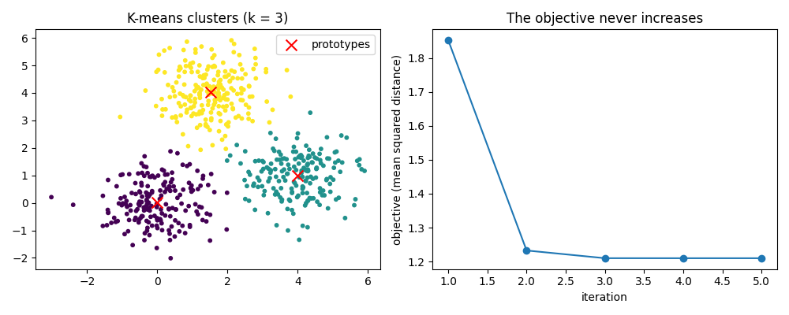
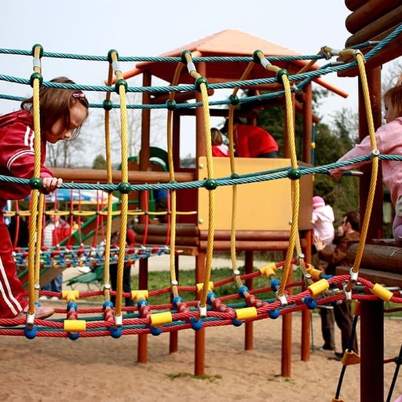
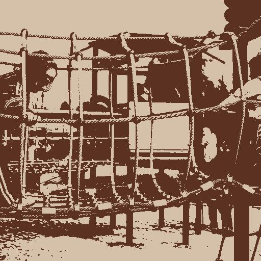
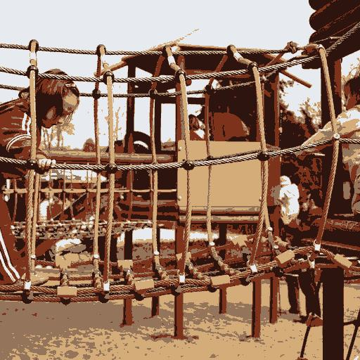
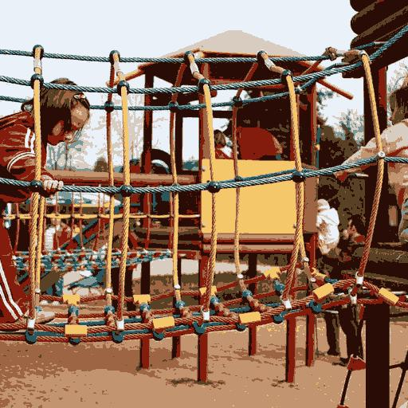
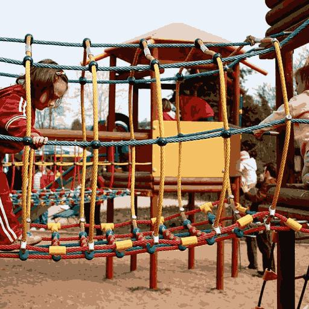
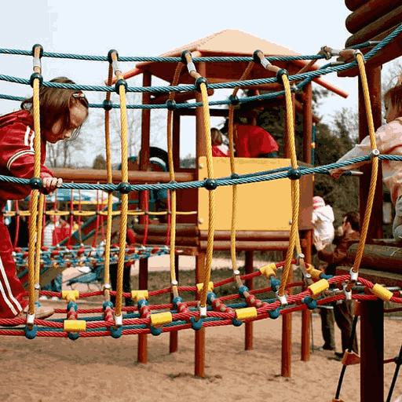
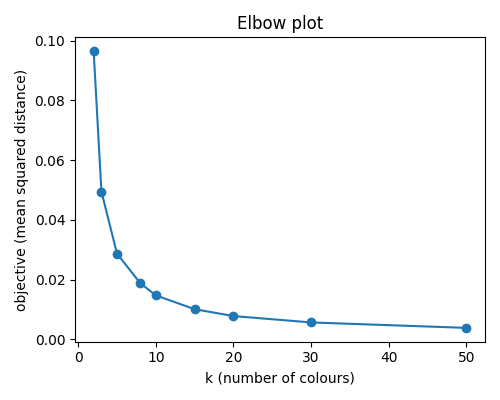

# K-Means Clustering

Code (from scratch, in numpy) for K-means clustering, applied to colour quantization ("cartoonifying") of an image.

---

## Theory

Please note that the theory corresponding to the codes is hosted on this [page](https://parag1604.github.io/notes/Machine-Learning/Clustering-and-Expectation-Maximization)

## Python Environment Setup

Use python >= 3.10 and install the requirements (numpy and matplotlib):

```bash
pip install -r requirements.txt
```

## Data

No dataset is needed. `version0.py` generates toy 2-D blobs, and `version1.py`/`version2.py` use the sample photo `image.jpg` in this folder. Pass `--image <path>` to use your own picture.

## Running

The K-means algorithm itself (random and k-means++ initialization, empty-cluster handling, convergence check) lives in `model.py`. Each script below adds one new idea.

### 0. K-means on toy data

```bash
python version0.py --k 3
```

Lloyd's algorithm alternates an assignment step and a mean-update step. Neither step can increase the objective, so the right panel decreases monotonically until the assignments stop changing. Saves `kmeans_blobs.png`:



### 1. Colour quantization ("cartoonify")

```bash
python version1.py --k 5
```

Every pixel is a point in RGB space. After fitting, each pixel is replaced by its nearest prototype, so the image is redrawn with only `k` colours and saved as `image_cartoonified_<k>.jpg`. Try `--k 2, 5, 10, 20, 50`:

Original | k = 2 | k = 5
:-------------------------:|:-------------------------:|:-------------------------:
 |  | 
**k = 10** | **k = 20** | **k = 50**
 |  | 

### 2. k-means++ initialization and choosing k

```bash
python version2.py
```

K-means converges only to a local minimum. The script compares the final objective of random and k-means++ starts over several seeds (k-means++ usually ends lower, needs fewer iterations, and varies less between seeds), then plots the objective against `k`. The objective always falls as `k` grows; look for the "elbow" where extra colours stop paying off. Saves `elbow.png`:


